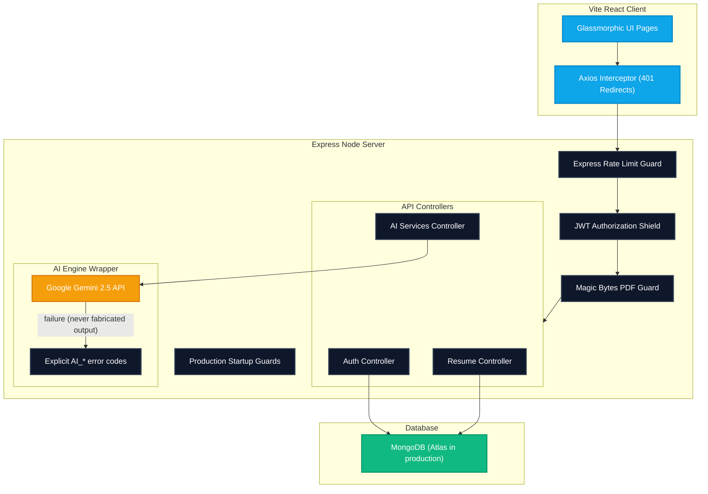

# 🚀 SkillSync AI — MERN Stack AI Career Copilot

<div align="center">
  
  [](IMPLEMENTATION_REPORT.md)
  [](IMPLEMENTATION_REPORT.md)
  [](https://github.com)
  [](https://github.com)

  <p align="center">
    <strong>Advanced enterprise-grade MERN application for resume optimization, ATS score auditing, dynamic job matching, adaptive mock interviews, and automated conversational coaching powered by generative AI.</strong>
  </p>

</div>

---

## 🏛️ System Architecture

SkillSync AI is designed with an industry-grade, security-hardened MERN architecture. The system decouples client presentation from core orchestration, leveraging specialized middleware layers to filter traffic, assert binary validity, and orchestrate AI services with dynamic failover capabilities.



---

## 🛠️ The Tech Stack

| Layer | Technologies Used | Key Benefits |
| :--- | :--- | :--- |
| **Frontend** | React 18 + Vite + Tailwind CSS + Framer Motion + Recharts | Fast HMR bundles, dark-glass aesthetics, GPU-accelerated responsive transitions |
| **Backend** | Node.js + Express + Multer + pdf-parse + Axios | Asynchronous I/O; uploaded PDF/DOCX files are parsed in a timeout-bounded worker thread, never on the request path |
| **Database** | MongoDB Atlas (Production Cloud DB) + Mongoose | Flexible document modeling, secure SSL clusters |
| **AI Engine** | Google Gemini 2.5 Flash API (analysis commentary, proposals, cover letters, embeddings) | Structured JSON prompts, hard timeouts, explicit provider errors, no fabricated results |
| **LaTeX** | Tectonic 0.17 / pdfLaTeX in a sandbox, or a remote isolated compiler | Real PDF output, command/package allowlists, line-numbered errors |
| **Deterministic engines** | `atsEngine`, `jobMatchEngine`, `jdParser`, `skillDictionary` | Explainable scores, configurable weights, input hashing for reproducibility |
| **Email Service** | Resend API Developer Suite | Automated verification tokens, custom onboardings, secure forgot-password loops |
| **Security** | Express Rate Limit + Helmet + Cryptographic Crypto + BcryptJS | Advanced hashing, sandbox DDoS defenses, Clickjacking & XSS mitigation |

---

## ✨ Core Features & Upgrades

### 🔒 Enterprise-Grade Security Hardening
*   **🛡️ Multi-Zone Rate Limiting**: Throttles suspicious traffic patterns with explicit HTTP `429 Too Many Requests` JSON replies, segregating limits into zones (general 200/min, auth 60/15 min, uploads 15/15 min, AI + compile 60/15 min).
*   **📄 Magic Bytes Binary Verification**: Inspects the first 4 bytes of uploaded documents in the memory buffer (`%PDF` / `25 50 44 46`). Malicious scripts spoofing `.pdf` MIME extensions are instantly terminated with HTTP `400 Invalid PDF`.
*   **🛡️ Startup Validation Guards**: Server halts immediately if core configuration strings (`MONGODB_URI`, `JWT_SECRET`, `GEMINI_API_KEY`) are missing, while outputting high-contrast warnings for missing secondary options to guarantee flawless local failovers.

### ✉️ Verification & Transactional Email Workflows
*   **✉️ Email Verification (opt-in)**: Registers users as unverified and sends a crypto-token link via Resend. Login is blocked with `403 EMAIL_UNVERIFIED` only when `REQUIRE_EMAIL_VERIFICATION=true`, because the shared `onboarding@resend.dev` sandbox sender cannot deliver to other people until a domain is verified. See [PRODUCTION_ENV_CHECKLIST.md](PRODUCTION_ENV_CHECKLIST.md) §4.
*   **🎉 Premium Welcome Onboardings**: Success activations trigger automated welcome templates directing users through their Cockpit utilities.
*   **🔑 Password Recovery Recalls**: Sends reset links matching cryptographic tokens that safely expire in 1 hour.

### 🧪 LaTeX Resume Studio
*   **🧾 Source + live PDF**: split-view LaTeX editor with syntax highlighting, draggable panes, undo/redo, autosave, version history, restore, and PDF/.tex download.
*   **🔒 Sandboxed compilation**: Tectonic `--untrusted` (or pdfLaTeX `-no-shell-escape`) in a temp directory with timeouts, output limits, a package allowlist, and explicit rejection of `\write18`, `\input`, `\read`, `\csname` (dynamic command construction) and PDF-embedding primitives. Production forwards to an isolated compiler via `LATEX_COMPILE_URL` instead of running TeX on the API host. Note that Tectonic's `--untrusted` blocks shell escape but not file reads, so the command filter and the container's filesystem view are the real controls.
*   **🧭 Line-level errors**: compilation failures return parsed errors with line numbers that jump the editor to the offending line.

### 🎯 Deterministic ATS Engine
*   **📐 Explainable and reproducible**: required/preferred skill match, keyword coverage, experience, role, education, section completeness, formatting warnings, and achievement evidence are computed in code with configurable weights (`ATS_WEIGHTS_JSON`), an engine version, and a SHA-256 input hash. Identical inputs always produce an identical score.
*   **🧮 Non-applicable dimensions are excluded and the remaining weights renormalised** rather than scored as zero, so a resume-only scan is not punished for the missing job description.
*   **🧠 Gemini adds commentary, never the score**, and it is always labelled as AI commentary. If the provider fails, the API returns an explicit error code instead of inventing a result.

### 🔍 Job Description Intelligence
*   **📥 Paste, upload, or fetch**: paste text, upload PDF/DOCX/TXT, or fetch a public posting URL (JSON-LD `JobPosting` first, then page containers).
*   **🛡️ SSRF-hardened fetching**: protocol/port/credential checks, private, loopback, link-local, CGNAT and cloud-metadata blocking, per-hop redirect validation, and DNS pinning so the validated address is the address used.
*   **🧾 Review before scoring**: extracted title, company, location, responsibilities, required/preferred skills, experience, education, and keywords are shown to you first; blocked or JS-only pages ask you to paste instead of guessing.

### ✍️ AI Resume Copilot with human approval
*   **🆚 Diff review**: tailor to a job, improve a summary or a selected bullet, improve projects, find missing keywords, fix ATS formatting, shorten to one page, and explain LaTeX errors — every change is proposed as a before/after diff.
*   **✅ Nothing is written without approval**: approved proposals are validated against the current document, a version is snapshotted first, and new numeric claims are flagged because they were not in your resume.

### 🔎 Honest AI behaviour
*   **⚠️ No fabricated fallback**: if the Gemini key is invalid, rate-limited, or times out, the affected feature returns a structured `AI_*` error. The old behaviour of returning invented scores, cover letters, and interview questions is gone.

### 💼 Career Cockpit Dashboard
*   **📊 Unified Mission Control**: Includes a Career Readiness Index aggregated gauge, active checklists progress widgets, recent activity feeds, and recent scores tracking.
*   **⚡ Kanban Job Tracker**: Move applications smoothly through customized pipelines with a dynamic drag-and-drop board.
*   **🎙️ Voice AI Mock Interview**: Generate exactly 5 adaptive questions based on candidate resumes. Practice mock interviews with real-time feedback on filler words (e.g. "um", "ah"), response structures, and technical accuracy.

---

## ⚡ Quick Start (3 Minutes)

### Installation

1. **Clone & Open Project**
   ```bash
   git clone https://github.com/yourusername/AI-Career-Copilot.git
   cd AI-Career-Copilot
   ```

2. **Backend Configuration**
   ```bash
   cd backend
   npm install
   ```
   Create a `.env` file inside `backend/`:
   ```env
   PORT=5050
   MONGODB_URI=mongodb+srv://<username>:<password>@cluster.mongodb.net/career_copilot
   JWT_SECRET=your_super_strong_jwt_secret_key
   GEMINI_API_KEY=your_google_gemini_api_key
   CLIENT_URL=http://localhost:5180
   RESEND_API_KEY=your_resend_api_key
   ```

3. **Frontend Configuration**
   ```bash
   cd ../frontend
   npm install
   ```
   Create a `.env` file inside `frontend/`:
   ```env
   VITE_API_BASE_URL=http://localhost:5050/api
   VITE_GOOGLE_CLIENT_ID=your_google_client_id
   ```

### Running Locally

**Terminal 1 - Backend Node Server:**
```bash
cd backend
npm run dev
```
*Expected: `MongoDB connected` + `Server running on port 5050`*

No MongoDB handy? `npm run dev:memory` boots the same API against a disposable in-memory
MongoDB (data is lost on exit — development only).

**Run the test suite** (deterministic engines, SSRF, LaTeX compile, remote-compiler contract, and API integration on an in-memory MongoDB):
```bash
cd backend && npm test
```

**Verify against live services** (each script is opt-in; none run during `npm test`):
```bash
cd backend
npm run verify:ai           # one real Gemini request per generative feature
npm run verify:persistence  # restart the API on the same data directory, read data back
BASE_URL=http://127.0.0.1:5050 npm run verify:e2e   # full workflow + cross-user isolation
BASE_URL=http://127.0.0.1:5050 npm run verify:deploy # health, CORS, error envelope, guards
```

The Gemini free tier allows **20 generate requests per day per model** (roughly four full
workflows). When it runs out every AI call returns `429 AI_RATE_LIMITED` with the provider's
quota reason — no results are invented. Enable billing on the key for production use.
`verify:ai` reads `GEMINI_API_KEY` from `backend/.env` and reports the provider's own error
code on failure; it never prints the key. Results of the last run are in
[IMPLEMENTATION_REPORT.md](IMPLEMENTATION_REPORT.md) §Phase 15.

**Enable PDF compilation locally** (optional, no admin rights needed): download the
Tectonic binary into `backend/.tools/` as described in
[PRODUCTION_ENV_CHECKLIST.md](PRODUCTION_ENV_CHECKLIST.md) §3, or point `LATEX_BIN` at an
existing `tectonic`/`pdflatex`. In production, set `LATEX_COMPILE_URL` to the isolated
compiler in [latex-compiler/](latex-compiler/README.md) (`docker compose up -d --build`);
without it the compile endpoint returns `503` instead of running untrusted TeX on the API
host.

**Terminal 2 - Frontend Vite Server:**
```bash
cd frontend
npm run dev
```
*Expected: `➜ Local: http://localhost:5180/`*

---

## 🔌 API Endpoints Reference

<details>
<summary>🔑 Authentication & Verification Endpoints</summary>

```
POST /api/auth/signup               # Create user, dispatch verification token
POST /api/auth/login                # Authenticate user, return JWT (verification enforced when enabled)
POST /api/auth/google               # Google OAuth callback (bypasses activation check)
GET  /api/auth/verify-email         # Verify email matching ?token=... (StrictMode safe)
POST /api/auth/resend-verification  # Resend email activation token
POST /api/auth/forgot-password      # Dispatch secure password-reset link
POST /api/auth/reset-password       # Modify credentials matching token
```
</details>

<details>
<summary>📄 Resume Management Endpoints</summary>

```
POST   /api/resumes                      # Save raw resume document
GET    /api/resumes                      # Fetch list of user's resumes
GET    /api/resumes/:resumeId            # Fetch one resume
PUT    /api/resumes/:resumeId            # Modify resume field sections
DELETE /api/resumes/:resumeId            # Remove resume
POST   /api/resumes/upload               # Direct PDF upload, extracts text (rate-limited)
POST   /api/resumes/:resumeId/upload-pdf # Attach PDF document to existing resume record
```
</details>

<details>
<summary>🧠 AI Analysis & Optimization Endpoints</summary>

```
POST /api/analysis/resume/:resumeId      # Deterministic ATS report (weights, evidence, warnings, hash)
POST /api/analysis/job-match             # Job match: gaps, critical gaps, requirement matrix, roadmap
POST /api/analysis/skill-gap             # Missing skills, evidence, prioritised roadmap
POST /api/analysis/generate-cover-letter # Tone-aware cover letter (persisted)
GET  /api/analysis/cover-letters         # Cover letter history
PATCH /api/analysis/cover-letters/:id    # Save edits to a generated letter
GET  /api/analysis/history               # Analysis snapshots
POST /api/coach/chat                     # Grounded coach with citations
GET  /api/coach/history                  # Server-side coach transcript
POST /api/interviews/generate            # Create 5 adaptive questions from resume
POST /api/interviews/:sessionId/evaluate # Score responses
```
</details>

<details>
<summary>🧪 LaTeX Studio, job intelligence &amp; copilot endpoints</summary>

```
GET  /api/latex/templates                      # Templates + compiler status
POST /api/latex/compile                        # Compile source -> base64 PDF or line-numbered errors
POST /api/latex/build/:resumeId                # Generate LaTeX from canonical resume data
PUT  /api/resumes/:resumeId/latex              # Save source (optional version)
POST /api/resumes/:resumeId/latex/regenerate   # Regenerate from resume data
GET  /api/resumes/:resumeId/versions           # Version history
POST /api/resumes/:resumeId/versions           # Snapshot current state
GET  /api/resumes/:resumeId/versions/:versionId
POST /api/resumes/:resumeId/versions/:versionId/restore
POST /api/job/parse                            # Parse pasted JD (deterministic)
POST /api/job/upload                           # Parse PDF/DOCX/TXT JD
POST /api/job/fetch                            # Fetch public posting URL (SSRF-guarded)
GET  /api/job/descriptions                     # Saved job descriptions
POST /api/copilot/propose                      # AI proposals (never auto-applied)
POST /api/copilot/apply                        # Apply only approved proposals
GET/POST/DELETE /api/knowledge/documents       # Coach RAG documents (per user)
```
</details>

---

## 🚢 Deployment (Render API + Vercel frontend)

The backend and frontend deploy independently. The API is a long-lived Node service
(Render), the frontend is a static Vite build (Vercel), and the compiler is a private
container that must never be exposed publicly.

| Piece | Where | Config file |
| --- | --- | --- |
| React app | Vercel | [`frontend/vercel.json`](frontend/vercel.json) |
| Express API | Render (web service, root `backend`) | [`render.yaml`](render.yaml) |
| Database | MongoDB Atlas | `MONGODB_URI` secret |
| Email | Resend | `RESEND_API_KEY`, `RESEND_FROM_EMAIL` |
| LaTeX compiler | Private container (optional) | [`latex-compiler/docker-compose.yml`](latex-compiler/docker-compose.yml) |

**1. API (Render)** — create a Blueprint from this repo; `render.yaml` sets the build
command (`npm ci --omit=dev`), start command (`npm start`), and readiness health check.
Fill the `sync: false` secrets in the dashboard. Then set `CLIENT_URL` to the exact Vercel
origin (no trailing slash, no wildcard) and add preview origins to `ALLOWED_ORIGINS`.
`env.js` refuses to boot without `MONGODB_URI`, `JWT_SECRET`, and `GEMINI_API_KEY`.

**2. Frontend (Vercel)** — set the project root to `frontend`, build `npm run build`, output
`dist`. Add the build-time variable `VITE_API_BASE_URL=https://<api-host>/api` (unset means
`/api`, which only works behind a proxy). SPA deep links are handled by the rewrite in
`vercel.json`.

**3. Verify the deployment** (no secrets needed):

```bash
cd backend
BASE_URL=https://<api-host> EXPECT_ORIGIN=https://<frontend-host> npm run verify:deploy
```

This checks health + readiness, the CORS allowlist, the error envelope, the auth guard,
and the LaTeX guard (10 checks). Repeat it after every config change.

**Email** needs a verified Resend domain before real users can confirm their address; the
full checklist is [PRODUCTION_ENV_CHECKLIST.md](PRODUCTION_ENV_CHECKLIST.md) §4. Until then
verification is opt-in and signups still work.

**Database**: the `MONGODB_URI` currently in `backend/.env` points at a cluster hostname
that no longer resolves (`NXDOMAIN`). Nothing in the code or its startup path falls back to
in-memory storage; the API exits instead. Create/restore a cluster and copy the current
connection string before deploying. For local work only, `npm run dev:memory` is available
and its data is discarded on exit.

---

## 🤝 Support & Contributions

*   Confirm all `.env` files are correctly mapped — see [backend/.env.example](backend/.env.example) and [PRODUCTION_ENV_CHECKLIST.md](PRODUCTION_ENV_CHECKLIST.md).
*   Consult the terminal logs if any backend calls show warnings.
*   Read [IMPLEMENTATION_REPORT.md](IMPLEMENTATION_REPORT.md) for the audit findings, phase status, verification evidence, and known limitations.

**Status:** ✅ Verified locally (81 backend tests, 17/17 compiler-service checks, production build, live Gemini, 15/15 workflow, 10/10 deploy checks) · ⏳ Cloud deployment and the compiler **container layer** pending — see [IMPLEMENTATION_REPORT.md](IMPLEMENTATION_REPORT.md) | **Version:** 1.0.0 | **Author:** SkillSync Engineering Team
